# Advanced Lane Finding

A classical computer-vision pipeline (Python + OpenCV, no machine learning) that finds the
ego lane in dashcam images and videos and reports the **radius of curvature**, the
**position of the vehicle** relative to the lane center and the **lane width**.

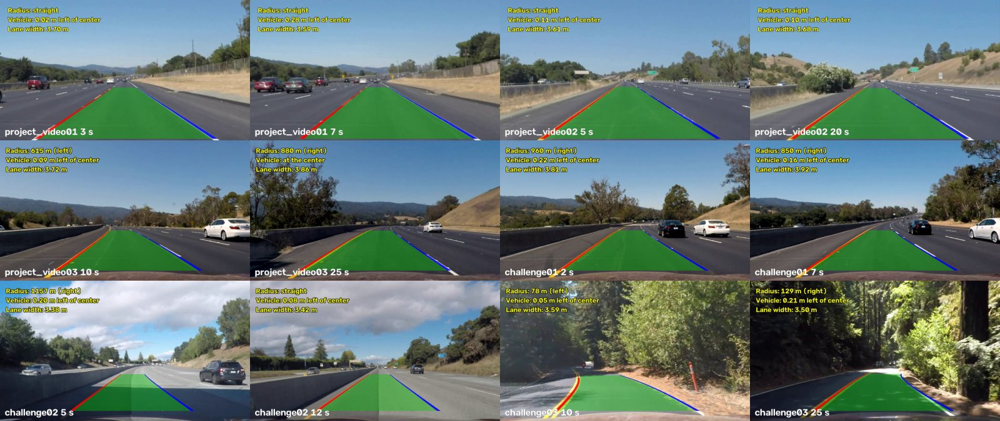

*Two frames of each result video (`project_video01-03`, `challenge01-03`).*

---

**Lane Finding Project**

The goals / steps of this project are the following:

* Compute the camera calibration matrix and distortion coefficients given a set of chessboard images.
* Apply a distortion correction to raw images.
* Use color transforms, gradients, etc., to create a thresholded binary image.
* Apply a perspective transform to rectify binary image ("birds-eye view").
* Detect lane pixels and fit to find the lane boundary.
* Determine the curvature of the lane and vehicle position with respect to center.
* Warp the detected lane boundaries back onto the original image.
* Output visual display of the lane boundaries and numerical estimation of lane curvature and vehicle position.

---

## How to run

Requirements: Python 3.12 (tested with OpenCV 5.0 and NumPy 2).

```bash
# one-time setup
python3 -m venv venv
venv/bin/python -m pip install -r requirements.txt
source venv/bin/activate

# 1. camera calibration (must run first; writes output/calibration.npz)
python3 scripts/calibrate.py

# 2. every stage on the test images (results in output/<stage>/)
python3 scripts/threshold.py       # binary lane-pixel images        -> output/threshold/
python3 scripts/warp.py            # region of interest, bird's-eye  -> output/warp/
python3 scripts/fit_lines.py       # lane pixels + fitted curves     -> output/fit/
python3 scripts/measure_lane.py    # radius, offset, lane width      -> output/measure/
python3 scripts/run_images.py      # full pipeline on the images     -> output/images/

# 3. all videos of resources/test_videos_export (about 2-3 minutes)
python3 main.py                    # -> output/videos/

# tests
python3 -m pytest -q
```

Every script processes all provided images by default; a single file can be given as an
argument, e.g. `python3 scripts/warp.py resources/test_images_export/test2.jpg` or
`python3 main.py resources/test_videos_export/challenge02.mp4`.

## Project layout

| Path | Content |
|---|---|
| `lane_finding/calibration.py` | chessboard detection, camera calibration, undistortion |
| `lane_finding/cameras.py` | road geometry of each camera (horizon, lane width per row, region of interest) |
| `lane_finding/thresholding.py` | binary image of lane-marking pixels |
| `lane_finding/horizon.py` | estimate of the horizon of a video from the frames seen so far |
| `lane_finding/perspective.py` | bird's-eye transform and its inverse |
| `lane_finding/lane_fit.py` | lane-line pixels and robust polynomial fit |
| `lane_finding/tracking.py` | following the lane from frame to frame |
| `lane_finding/measurements.py` | curvature, vehicle offset and lane width in meters |
| `lane_finding/overlay.py`, `visualization.py` | drawing the result |
| `lane_finding/pipeline.py` | `LanePipeline`: connects all steps for an image or a video frame |
| `main.py`, `scripts/` | command-line entry points (thin wrappers around `LanePipeline`) |
| `tests/` | 288 pytest tests on synthetic scenes with exact truth and on the real data |

## Approach

Three rules guided the whole project:

1. **No thresholds fitted to the provided images.** The sample videos are only examples, so
   every number in the pipeline comes from road standards (lane 3.7 m, markings 0.10-0.15 m,
   dashed line 12 ft + 36 ft), from the camera geometry, from statistics measured in each image
   at run time (noise of the road surface) or from general statistical conventions (3 sigma).
2. **Causal video processing.** A video is processed frame by frame using only the frames
   already seen, as a system in a car would; nothing looks ahead in the video.
3. **Every change is verified** on all six videos, also on darker, paler and noisier copies of
   them, and kept only if it is better.

The material contains **two different cameras**, recognized by the image resolution:
1280x720 (the chessboard camera, car hood visible; `test*`, `straight_lines*`,
`project_video03`, `challenge01-03`) and 960x540 (no calibration images; `solid*`,
`whiteCarLaneSwitch`, `project_video01-02`). Each has its own geometry in `cameras.py`.

---

## Camera Calibration

#### 1. Camera matrix and distortion coefficients

Code: `lane_finding/calibration.py`, script `scripts/calibrate.py`.

For each of the 20 chessboard images the 9x6 inner corners are found with
`cv2.findChessboardCornersSB`, which gives more accurate (sub-pixel) corners than the classic
detector. The 3D corner coordinates are the same grid `(x, y, 0)` for every image
(the board lies in the plane z = 0). `cv2.calibrateCamera` then estimates the camera matrix and
the distortion coefficients that best map the grid onto the detected corners.

* 16 images are used: two do not show the whole board and two have a different resolution
  (1281x721), which cannot be mixed in one calibration.
* The third radial coefficient `k3` is fixed to zero: the chessboard images do not constrain
  it, so leaving it free would only fit noise.
* Result: focal length about 1156-1160 px, principal point (674.5, 388.9), RMS
  reprojection error 0.86 px.
* `CameraCalibration.undistort` precomputes the remap tables once, so undistorting a video
  frame is only one `cv2.remap`.

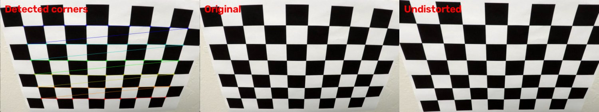

*Detected corners (the colored lines connect them row by row), the original image and the
undistorted image: the curved edges of the board become straight.*

## Pipeline (single images)

#### 1. Distortion-corrected image

Images of the calibrated camera are undistorted first (`LanePipeline.lane_pixels`). The
960x540 camera has no calibration images, so its images are used as they are.

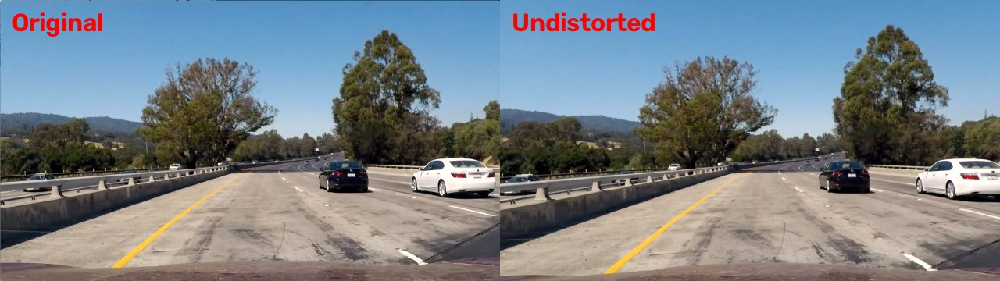

*The difference is largest near the image edges (the white car on the right, the car hood).*

#### 2. Thresholded binary image

Code: `lane_finding/thresholding.py` (`threshold_lane_pixels`).

Fixed color thresholds (e.g. "S channel > 170") only work for the light and the camera they
were chosen for. Instead, the binary image is built from what a lane marking physically is:
**a narrow stripe that is lighter (white paint) or yellower (yellow paint) than the road on
both of its sides.**

* The image is converted to the Lab color space: `L` measures lightness (white markings), `b`
  measures blue-yellow (yellow markings, even in shadow where they are not lighter).
* For every pixel the channel is compared with the pixels at distance `d` to the left and to
  the right: `contrast = pixel - max(left, right)`. `d` is two marking widths
  (2 x 0.15 m) at the scale of that image row; the scale comes from the camera geometry, where
  the lane (3.7 m) is `lane_width_per_row * (row - horizon)` pixels wide.
* A pixel is a marking pixel when its contrast exceeds **3 sigma of the noise of this image**.
  The noise is measured on the road in every frame (robust standard deviation of the
  differences between pixels `d` apart), so a dark, bright, low-contrast or noisy image gets its
  own threshold automatically.
* Wide bright areas (sunlit asphalt, white cars, dry grass) have no darker road on both sides
  and are rejected without any extra rule. Rows above the horizon and on the car hood are
  skipped.

Gradients (Sobel) were tested and only added noise, so they are not used.

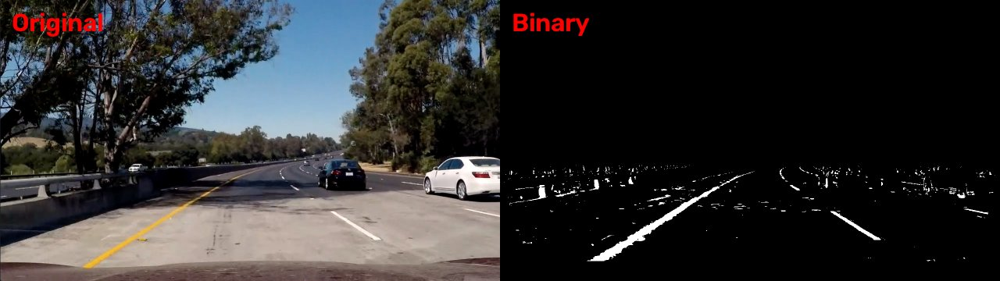

The same code, without any change of parameters, on a darker and a paler copy of a frame:

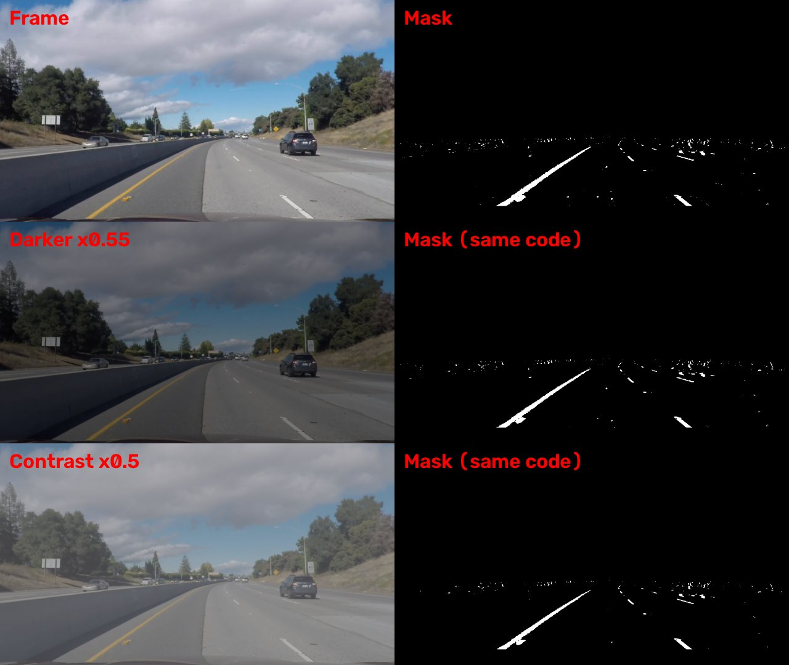

Compared with the fixed color thresholds used earlier in the project, this adaptive mask raised
the share of video frames shown with both lane lines detected from 59 % to 93 % on
`challenge02` and from 12 % to 29 % on `challenge03`, and it keeps working on darkened copies of
the videos where the fixed thresholds lost the lane completely (`project_video01`: 0 % -> 100 %).

#### 3. Perspective transform

Code: `lane_finding/perspective.py` (`PerspectiveTransform`), `lane_finding/cameras.py`
(`CameraProfile.region_of_interest`), script `scripts/warp.py`.

On a flat road the parallel lane lines meet at the **horizon** (vanishing point), and the lane
width in the image grows linearly below it. This geometry was measured once per camera on
straight road sections (`straight_lines1/2`, `solid*`): `lane_width_per_row` is 2.97 and 3.01
pixels per row, which means both cameras are mounted about 1.25 m above the road
(3.7 m / 2.97).

The **region of interest** is a trapezoid exactly one lane wide, symmetric around the image
center, from about 35 m ahead down to just above the car hood. `cv2.getPerspectiveTransform`
maps it to the middle half of the output image (the side margins keep the lines visible when
the car is off-center or the road bends), and `cv2.warpPerspective` produces the bird's-eye
view. In it, straight lane lines are vertical and parallel, and a bend is a smooth curve.

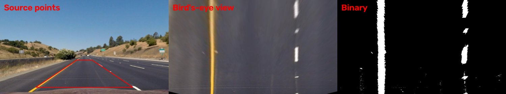

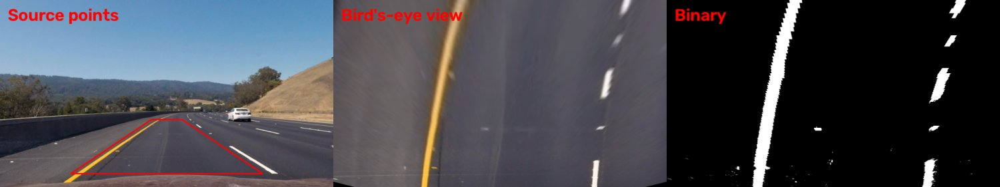

The horizon moves with the pitch of the car and the slope of the road (it differs by about
20 rows between the videos of the same camera). With a wrong horizon the lane looks like a funnel and the
measured radius is wrong, so for videos the horizon is **estimated from the frames seen so
far** (`lane_finding/horizon.py`): line segments of the binary image are found with
`cv2.HoughLinesP`, every left-leaning segment is intersected with every right-leaning one, and
the median row of the intersections is the vanishing point of the frame. The estimate of the
video is the median over every 6th frame so far (available after 5 frames); the view is rebuilt
whenever it moves by a row.

#### 4. Lane-line pixels and polynomial fit

Code: `lane_finding/lane_fit.py` (`fit_lane`), script `scripts/fit_lines.py`.

1. **Starting points:** a column histogram of the lower half of the bird's-eye binary image;
   its highest peak around 25 % and around 75 % of the width is the bottom of the left and the
   right line.
2. **Sliding windows:** 9 windows per line follow the line upwards; each window is re-centered
   on the mean of its pixels. Where a dashed line has a gap, the window keeps moving with the
   drift measured on the line (or on the other line), so it does not lose the bend.
3. **Line quality:** a line is *present* if it has enough pixels over at least a quarter of the
   image height, and *strong* if it has many pixels spread over at least half of the height.
4. **Fit `x = A*y^2 + B*y + C`:**
   * both lines strong: each is fitted on its own;
   * one line weak: both are fitted together with a shared curvature `A` (lane lines are
     parallel, so they bend alike);
   * only one line present: the other one is derived from it by the lane width.
5. **Robust fit:** the pixels of each row are averaged (same result, four times faster) and fitted
   with iteratively reweighted least squares with Tukey weights, so stray pixels (spots,
   shadows) do not pull the curve; it tolerates about 20 % contaminated rows.
6. **Plausibility check** (`LaneFit.is_plausible`): both lines exist, the lane width at 10 rows
   is realistic and nearly constant, the curvature is physically possible and the curves stay
   near the image.

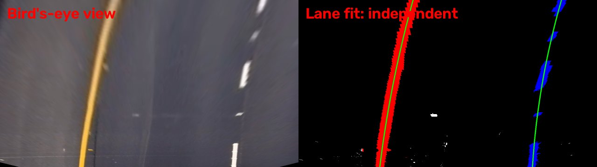

*Left line pixels in red, right line pixels in blue, fitted polynomials in green.*

#### 5. Radius of curvature and vehicle position

Code: `lane_finding/measurements.py` (`meters_per_pixel`, `measure_lane`), script
`scripts/measure_lane.py`.

* **Scale.** Horizontally the lane (3.7 m) spans half of the bird's-eye width: 3.7 / 640 m per
  pixel. Vertically the ground-plane model gives the distance of an image row,
  `distance = focal_height / (row - horizon)`, where `focal_height` = focal length x camera
  height. It was determined from a road standard: dashes of a lane line repeat every 14.63 m
  (12 ft dash + 36 ft gap), and for the main camera it agrees with the chessboard calibration
  within 3 %. The view covers about 5.8-35 m ahead (~4 cm per row).
* **Curvature** of the lane center (the mean of the two polynomials) at the row closest to the
  car. The polynomial is converted exactly to meters (`A_m = A * xm / ym^2`,
  `B_m = B * xm / ym`), then `R = (1 + (2 A_m y + B_m)^2)^1.5 / |2 A_m|`; the sign tells a left
  or a right bend. Above 3000 m the road is reported as straight: on synthetic lanes with exactly
  known geometry the radius error is 1-9 % up to 1500 m but 20-30 % at 3000 m.
* **Vehicle position:** the camera is assumed to be in the middle of the car, so the car axis is
  the middle column; the offset is the distance between it and the lane center at the bottom
  row, in meters (error on synthetic lanes below 3 cm).
* **Lane width** at the bottom row, as a sanity check (3.4-3.9 m on the videos).

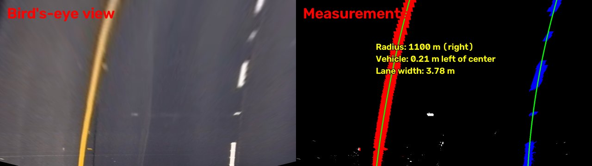

#### 6. Result plotted back onto the road

Code: `lane_finding/overlay.py` (`draw_lane_overlay`), script `scripts/run_images.py`.

The lane area and its two lines are drawn into a label image in the bird's-eye view, warped
back to the camera view once with the inverse matrix, and blended into the image (green
area, red left and blue right line), with the measurements written at the top.

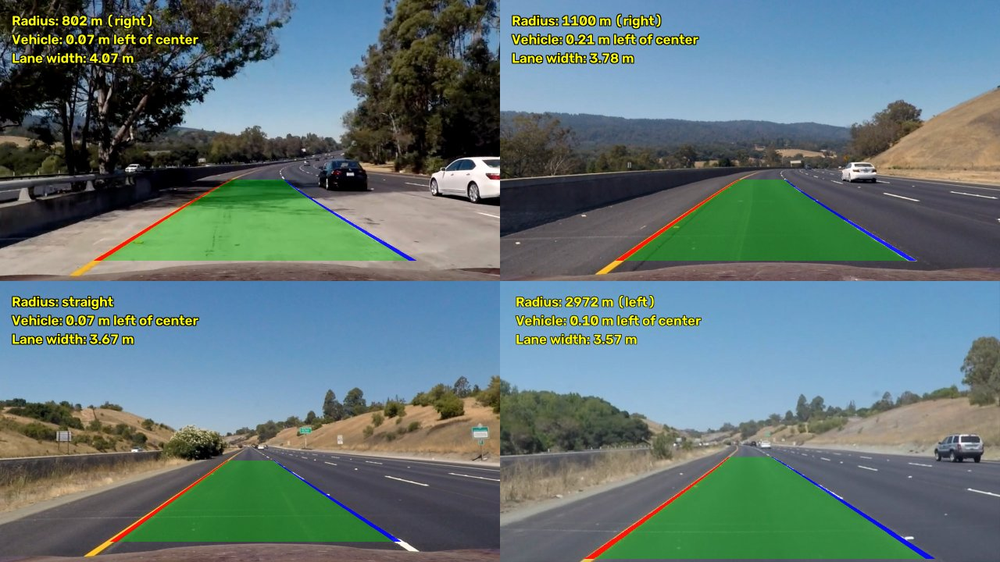

## Pipeline (video)

#### 1. Final video output

Code: `main.py`, `lane_finding/tracking.py`, `lane_finding/horizon.py`, `lane_finding/pipeline.py`.

`python3 main.py` processes all six videos and writes them to `output/videos/` (the videos are
not stored in the repository because of their size; two frames of each are shown at the top).
Each video runs through one `LanePipeline` with:

* the **causal horizon estimate** described above;
* a **tracker** (`LaneTracker`) that
  * searches near the lane of the previous frame (a band around the previous curves) and falls
    back to the full search when that does not see both lines,
  * accepts a result only if it is plausible, close to the previous lane and about as wide
    (a lane cannot jump in 40 ms),
  * smooths the accepted lanes over the frames (exponential moving average), which halves the
    frame-to-frame jitter,
  * after a longer loss accepts a new lane only when 3 frames in a row agree on it,
  * treats a line that was derived from the other one as a guess, not an observation: it is
    never used to confirm itself, and the remembered lane width is learned only from frames in
    which both lines were clearly seen;
* a **view that adapts to the bend:** on a circle of radius `R` the road moves sideways by
  `d^2 / 2R` within the distance `d`, so beyond `d = sqrt(2 R * 1.85 m)` the lane leaves the
  bird's-eye view sideways. The far edge of the view is set to that distance, between one dash
  period beyond the near edge (~20 m) and the usual 35 m. On highways the view never changes;
  on the winding `challenge03` road it raised the found frames from 32 % to 48 %.

When no lane is found in a frame, nothing is drawn on the road (only the note
"Lane not detected"), so the video never shows an outdated lane.

| Video | Camera | Lane found | Not found (held / lost) |
|---|---|---|---|
| project_video01 | 960x540 | 100 % | 0 % |
| project_video02 | 960x540 | 100 % | 0 % |
| project_video03 | 1280x720 | 99.6 % | 0.4 % |
| challenge01 | 1280x720 | 99.2 % | 0.8 % |
| challenge02 | 1280x720 | 99.2 % | 0.8 % |
| challenge03 | 1280x720 | 48 % | 52 % |

Processing takes about 20-35 ms per frame including reading and writing the video, i.e. faster
than real time.

## Discussion

#### 1. Problems, failure cases and possible improvements

* **Two cameras.** The 960x540 videos come from a camera without calibration images, so they
  are not undistorted and their geometry was measured on straight road sections.
* **The horizon** was the biggest single source of error: with the default horizon the lane of
  `challenge02` looked like a funnel and was found in only 27 % of the frames. The causal
  estimate fixed this, but it needs about one second of video, so the very first second of a
  video is processed with the camera's usual horizon.
* **Start of `challenge02`.** In that first second the right (dashed) line runs next to a dark
  sealed crack; the worn, lighter asphalt along the crack looks like a marking, and the right
  line is partly drawn on it. Several general fixes were tried (minimum marking width, a
  parallel-line model, a faster horizon start-up, waiting for the horizon before drawing); none
  was better on all videos, so the behavior was kept.

  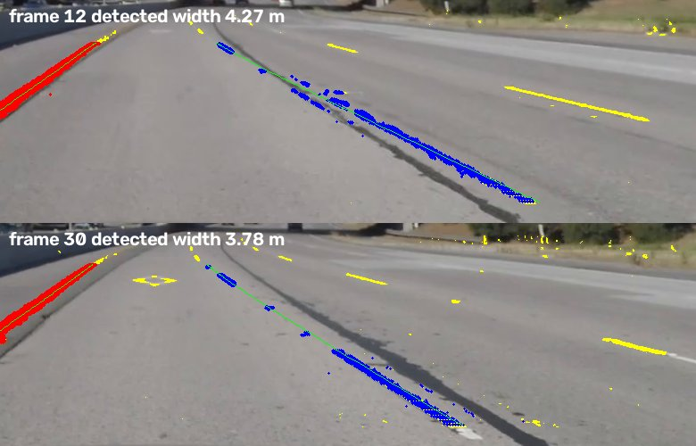

  *Top: the right line (blue) follows the light strip along the crack. Bottom: once the horizon
  is estimated it follows the white dashes.*
* **`challenge03`** (a winding forest road with a double yellow line, sun patches, deep
  shadows and bends with radii of a few tens of meters) is the hardest case: a second-degree polynomial cannot follow
  an S-bend, and in sun glare the lines are simply not visible. The lane is found in about half
  of the frames; in the rest nothing is drawn.
* **Single images** have no previous frames to check against: on `test2` a light pavement seam
  next to the dashed line bends the fitted line, and the radius comes out as ~450 m instead of
  ~1 km (kept as a documented failing test).
* **Hand-set constants** remain in the window search, the plausibility check, the tracker and
  the Hough step (window sizes, tolerances, number of frames), chosen from geometry and
  experiments in fractions of the image size; they are documented in the code.

Possible improvements: estimate the vanishing point column as well (on the main camera it lies
up to 35 px right of the image center, which slightly tilts the bird's-eye view), fit a model
that can follow S-bends (e.g. a clothoid or splines), use the dashed-line period to calibrate the
distance scale per video, and combine the camera with other sensors (IMU for the pitch,
which moves the horizon).
